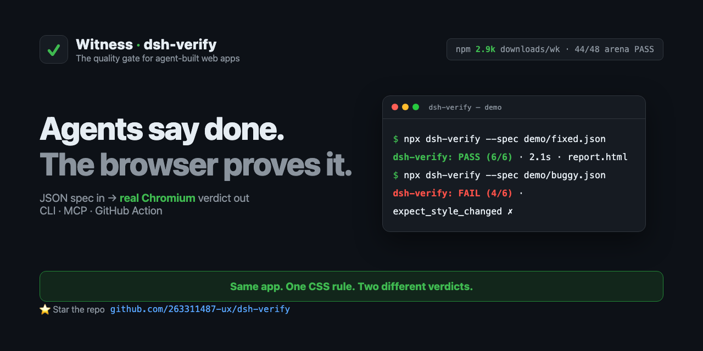
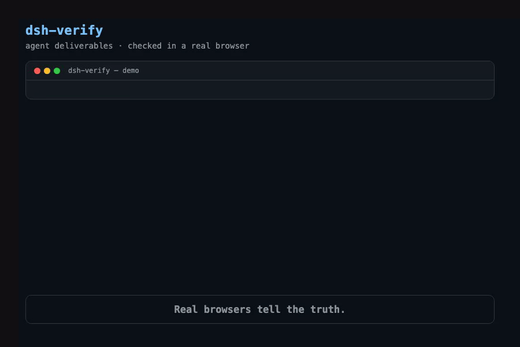
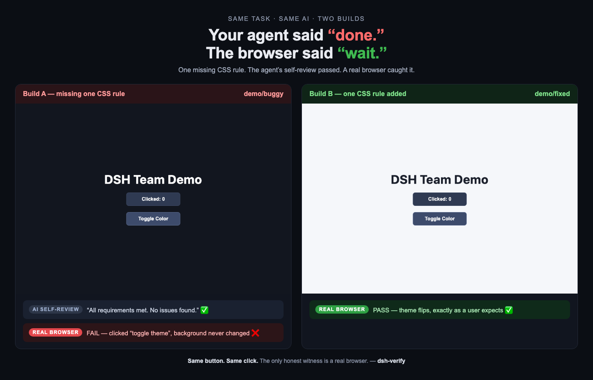
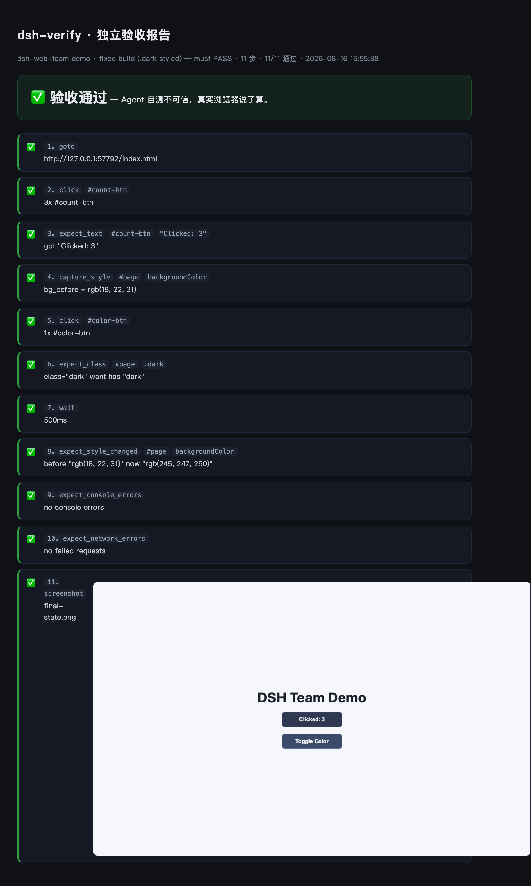

# dsh-verify

[中文](README.zh.md) | English

> **Witness** — Check the behavior your browser spec describes.
> Browser assertions can expose some implementation gaps; they do not prove an app is complete or independently reviewed.
> *(Witness is the product name; `dsh-verify` is the package name — same thing.)*

[](https://github.com/263311487-ux/dsh-verify/actions/workflows/ci.yml)
[](https://www.npmjs.com/package/dsh-verify)
[](https://glama.ai/mcp/servers/263311487-ux/dsh-verify)
[](https://github.com/awesome-dsh-plugin/awesome-dsh-plugin)
[](https://github.com/263311487-ux/dsh-verify/stargazers)
[](https://github.com/263311487-ux/dsh-verify/actions/workflows/self-acceptance.yml)

*If Witness catches something for you, ⭐ [star the repo](https://github.com/263311487-ux/dsh-verify) — it's how this project stays alive.*

**You asked an AI to build a web app. It said "done." Does it actually work?**

`dsh-verify` opens a real browser and checks — so you never have to take the agent's word for it.

## First success — no API key

Requires Node.js 20+ and a one-time Chromium download. npm 0.9.5 was published on 2026-10-09: install with `npm install --save-dev dsh-verify@0.9.5`, then run `npx dsh-verify init`. Alternatively, run from a clone checkout:

```bash
git clone https://github.com/263311487-ux/dsh-verify && cd dsh-verify
npm ci
npx playwright install chromium
node bin/verify.mjs init
cd dsh-verify-starter
node ../bin/verify.mjs --spec dsh-verify.spec.json
# PASS (5/5), exit 0 -> dsh-verify-out/report.html
node ../bin/verify.mjs --spec dsh-verify.fail.json --out failed-report
# Intentional FAIL (4/5), exit 1 -> failed-report/report.html
```

Open either HTML report with its adjacent PNG file. The failing spec deliberately expects wrong text; inspect the assertion and screenshot. [Existing missing-CSS failure report](evidence/buggy-report.html) is another inspectable example.

`init [directory]` only writes a local fixture and two JSON specs. It never calls an LLM, launches a browser, or downloads anything. The destination must be new (its parent must exist); existing directories, files, and symlinks are refused without changes. No force/overwrite option. GitHub package and browser installation require internet; these starter checks use localhost only. `gen` and MCP `generate_and_verify` are optional, separate features that require an LLM key.

To check your own app, edit the JSON steps; keep `serve` for static files or use `base` for an existing URL. `serve` paths resolve from the command's current directory, not the spec file. A PASS applies only to the supplied checks in that run; it does not establish complete coverage, security, accessibility, or independent authorship. The app and spec may come from the same agent; review the spec separately when independence matters. Reports retain assertion details and explicitly requested screenshots, not a complete audit trail.





The quality gate for **agent-built web apps**. Works with any agent — DeepSeek Harness (dsh), Claude Code, Cursor, Copilot, Codex — and with any CI. You write what a human would check in a browser; a real browser executes it and returns a `PASS`/`FAIL` verdict with receipts (screenshots + diff images).

No LLM judges the outcome. **The browser is the judge.**



Same task. Same AI. Two builds. One missing CSS rule — the agent's self-review passed, a real browser caught it.

---

## Why this exists

We ran a 4-agent web team (spec writer → frontend dev → QA → reviewer). Their own review said:

> ✅ "All requirements met. No issues found."

In a real browser, the dark-mode toggle **did nothing** — the `.dark` class was toggled, but the CSS rule was never written. Every agent self-test passed because there was nothing in the page for the agents to run. **No one opened a real browser.**

That's the gap: *agents verify against what they believe they built, not against what a user actually experiences.* These checks did not exercise the rendered CSS behavior; a browser assertion can cover it.

| Build | What the agents said | What a real browser says |
|---|---|---|
| `demo/buggy` | "No issues found" | ❌ **FAIL** — background never changes |
| `demo/fixed` | one CSS rule added | ✅ **PASS** — theme flips |

Same page. Same JS. One missing CSS rule. Two different verdicts.

## How it fits with other tools

- Playwright scripts provide a general browser API. This package exposes common checks as a reviewable JSON spec and report; custom scripts remain useful for flows outside this schema.
- LLM evaluation tools can assess open-ended outputs and may also integrate browsers. This package evaluates explicit browser assertions without an LLM deciding their result.
- Agent browser tools let agents operate a page. Stored specs make repeat runs inspectable; independent review still depends on who writes and reviews the spec.
- Visual regression tools detect pixel changes. This package combines screenshot comparisons with behavior assertions; coverage depends on the chosen checks.

## Use it three ways

| Entry point | What it's for | One-liner |
|---|---|---|
| **MCP server** | Your AI agent verifies its own deliverable, mid-session | `claude mcp add dsh-verify -- npx -y -p dsh-verify dsh-verify-mcp` |
| **CLI** | You or your CI verify a build/URL | `npx dsh-verify init` |
| **GitHub Action** | Every push runs real-browser checks | `uses: 263311487-ux/dsh-verify/.github/actions/dsh-verify@main` |

### From any AI agent (MCP)

```bash
claude mcp add dsh-verify -- npx -y -p dsh-verify dsh-verify-mcp
```

Then tell your agent, in plain words:

> Verify http://localhost:3000 — click `#dark-toggle`, then check `body` background-color changed. Screenshot it.

Tools exposed: `verify_spec` (run a spec JSON), `verify_url` (inline checks, no files), `generate_and_verify` (the AI drafts the checklist, real Chromium executes it), `health`.

### In CI (GitHub Action)

```yaml
- uses: 263311487-ux/dsh-verify/.github/actions/dsh-verify@main
  with:
    spec: demo/fixed.json       # spec file or glob
    # url: https://staging.example.com   # optional override
    # out: dsh-verify-out               # report output dir (default)
```

The repo dogfoods it: the [dogfood workflow](.github/workflows/dogfood.yml) asserts the fixed build **passes** and the buggy build **fails** on every push.

### On the command line

```bash
npm install -g dsh-verify          # or: npx dsh-verify after v0.9.5 is published
npx playwright install chromium    # one-time browser download
npx dsh-verify --spec 'specs/*.json'
# [PASS] specs/home.json (5/5)
# [FAIL] specs/cart.json (4/5)
#   ❌ expect_text #total: got "0" want "99"
```

## What's in the box

- **Deterministic assertions** — Chromium, Firefox, or WebKit executes supplied checks: click, fill, text, classes, computed styles, URLs, console/network errors, and pixels. Coverage depends on the spec and browser.
- **Inspectable reports** — HTML results accompany screenshot and difference image files when those actions run; `--json` is available for CI. Exit 1 alone does not distinguish assertion failures from runtime errors; inspect the structured verdict and failed actions as the release checker does.
- **Visual regression** — screenshot baselines, pixel-diff with thresholds (`expect_screenshot`), refresh with `--update-baselines`.
- **AI-drafted checklists** — `dsh-verify gen --url ... --prompt "..."` learns the page in a real browser, has an LLM draft the checklist, then executes it deterministically. The AI drafts; it never judges.
- **Multi-browser** — `chromium` | `firefox` | `webkit` per spec or `--browser`.
- **Zero framework lock-in** — a JSON spec is all there is. No config language, no SDK, no vendor.

## Example spec

```json
{
  "title": "my app",
  "serve": "dist",
  "browser": "chromium",
  "steps": [
    { "action": "goto", "path": "/index.html" },
    { "action": "click", "selector": "#count-btn", "count": 3 },
    { "action": "expect_text", "selector": "#count-btn", "text": "Clicked: 3" },
    { "action": "capture_style", "selector": "#page", "prop": "backgroundColor", "var": "bg_before" },
    { "action": "click", "selector": "#color-btn" },
    { "action": "expect_class", "selector": "#page", "class": "dark", "present": true },
    { "action": "expect_style_changed", "selector": "#page", "prop": "backgroundColor", "var": "bg_before" },
    { "action": "screenshot", "name": "final-state" }
  ]
}
```

Top-level fields: `title`, `serve` (static dir) or `base` (target URL), `browser`, `steps`. Run many at once with a glob; exit is `0` only if **all** pass.

## The report

An HTML report with adjacent image files — every step with a pass/fail badge, selector, and detail, plus screenshots:



## Agent Arena — bring your agent

Real-browser benchmark for agent-built web apps: same 3 tasks, same human
checks, **open entry**. Run your model on the board in ~10 minutes:

```bash
git clone https://github.com/263311487-ux/dsh-verify && cd dsh-verify
npm install && npx playwright install chromium
export LLM_API_KEY=sk-...          # any OpenAI-compatible model
node arena/run.mjs --agent "gpt-5/single" --task all --repeat 1 --submitter yourname
```

Submit the result files for maintainer review before they appear on the leaderboard:
[agent-arena](https://263311487-ux.github.io/dsh-verify/arena/).
Full rules in [docs/ARENA.md](docs/ARENA.md).

## Prove it (run it yourself)

```bash
git clone https://github.com/263311487-ux/dsh-verify && cd dsh-verify
npm install && npx playwright install chromium
npm run demo:fixed    # → PASS (11/11)
npm run demo:buggy    # → FAIL (exit 1) — the missing .dark rule, caught
npm test              # engine self-tests
```

The repo's own CI runs exactly that — engine self-tests, then asserts fixed **passes** and buggy **fails** — so the tool verifies itself on every push.

## Agent Arena — can agents ship working web apps?

Historical snapshot, not a current model ranking. The committed records span **2026-08-17–18 UTC**: **48 records, 44 PASS, 2 FAIL, 2 ERROR**. Among the 46 records with a browser verdict, 44 passed and 2 failed; the two ERROR records are runner failures. The records cover two model labels × two strategies × three static tasks (four records per cell). Self-check allows up to two repair rounds, so compute budgets differ. Model labels are recorded identifiers, not independently verified identities.

Records do not pin historical verifier/dependency versions. Generated apps, model replies, and local report files are not committed, limiting exact reproduction. No new LLM runs were made for the 0.9.5 documentation refresh. See [methodology and limitations](docs/ARENA.md).
[](https://263311487-ux.github.io/dsh-verify/arena/)

See [docs/ARENA.md](docs/ARENA.md) — methodology, the tasks, and how to run your own agent.

## Badge your agent-built app

The following static image is illustrative only. It is not bound to a particular app, commit, spec, or successful run:

```markdown
[](https://github.com/263311487-ux/dsh-verify)
```

For a result tied to a specific build, publish the commit, spec, action run, verdict, and report together. See [docs/verified-badge.md](docs/verified-badge.md).

## Roadmap

- [x] MCP server · AI-drafted checklists · visual regression · multi-browser · GitHub Action · dsh plugin
- [x] **Agent arena** — a public benchmark: give the same task to different agent setups, grade them in real browsers, publish the leaderboard
- [ ] Spec recorder (browser extension: click through once → spec generated)
- [ ] Cloud runs + shareable report links + PR comments

## Related

- [dsh-doublecheck](https://github.com/PerryLink/dsh-doublecheck) — delivery quality gate for DeepSeek Harness (/gate): requirements grill + evidence discipline. Complementary pair: /gate keeps the evidence honest, dsh-verify keeps the browser honest.
- [falsify](https://github.com/263311487-ux/falsify) — the scientific thinking protocol for AI agents (hypothesis → falsify → evidence → calibrated conclusion). The pair: falsify catches the wrong conclusion, dsh-verify catches the broken output.
- Featured in the DeepSeek Harness community — [Show Your Plugins: dsh-verify](https://github.com/deepseek-ai/deepseek-harness/discussions/2806) (48-run Agent Arena results in-thread)

## License

MIT
